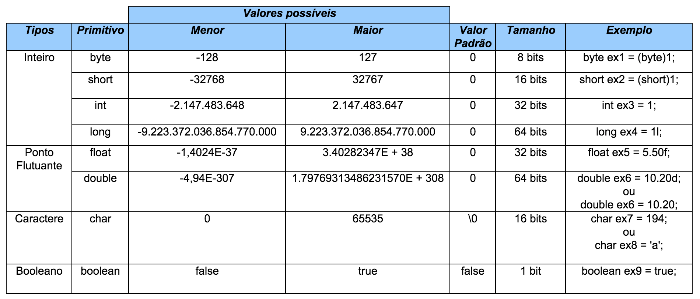

## Variáveis

Uma variável é um [objeto](https://www.universidadejava.com.br/java/java-objeto/) normalmente localizado na memória utilizado para representar valores, quando declaramos uma variável estamos associando seu nome (identificador) ao local da memória onde está armazenado sua informação, as variáveis em Java podem ser do tipo **primitivo** ou **objeto**:

* **Variáveis primitivas**: podem ser do tipo [byte](https://www.universidadejava.com.br/java/java-tipo-numerico-inteiro/), [short](https://www.universidadejava.com.br/java/java-tipo-numerico-inteiro/), [int](https://www.universidadejava.com.br/java/java-tipo-numerico-inteiro/), [long](https://www.universidadejava.com.br/java/java-tipo-numerico-inteiro/), [float](https://www.universidadejava.com.br/java/java-tipo-numerico-ponto-flutuante/), [double](https://www.universidadejava.com.br/java/java-tipo-numerico-ponto-flutuante/), [char](https://www.universidadejava.com.br/java/java-tipo-caractere/) ou [boolean](https://www.universidadejava.com.br/java/java-tipo-boolean/).

* **Variáveis de referência**: usada para referenciar um objeto. Quando usamos uma variável de referência definimos qual o tipo do objeto ou um subtipo do tipo do objeto (veremos isso mais para frente).

Quando declaramos uma variável primitiva, estamos associando está a um espaço na memória que vai guardar o seu valor. No caso da variável de referência, podemos tê-la apontando para algum lugar vazio **(null)** ou para algum espaço da memória que guarda os dados de um objeto.

As variáveis primitivas e de referência são guardadas em locais diferentes da memória. Variáveis primitivas ficam em um local chamado **stack** e as variáveis de referência ficam em um local chamado **heap**.

## Tipos primitivos

A linguagem Java não é totalmente Orientada a Objetos, e isto se deve principalmente aos atributos do tipo primitivo, pois são tipos de dados que não representam [classes](https://www.universidadejava.com.br/java/java-classe/), mas sim valores básicos.

Os tipos primitivos, assim como em várias outras linguagens tais como o C, existem para representar os tipos mais simples de dados, sendo eles dados [numérico](https://www.universidadejava.com.br/java/java-tipo-numerico-inteiro/), [booleano](https://www.universidadejava.com.br/java/java-tipo-boolean/) e [caractere](http://www.universidadejava.com.br/java/java-tipo-caractere/). Os tipos primitivos da linguagem Java são:

<figure>
    
</figure>

### Conteúdos relacionados

- [Origem e evolução da linguagem Java](https://www.universidadejava.com.br/java/origem-evolucao-java/)
- [Conversão (casting) de tipos primitivos](https://www.universidadejava.com.br/java/java-casting-tipos-primitivos/)
- [Exercícios com operadores e tipos primitivos](https://www.universidadejava.com.br/java/java-exercicios-tipos-primitivos/)
- [Palavras chave do Java](https://www.universidadejava.com.br/java/java-palavras-chave/)